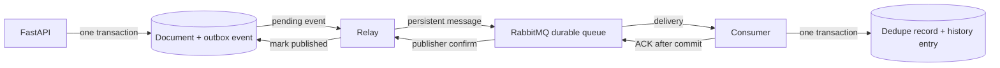

# Document events outbox

A FastAPI document service that keeps accepting writes during a RabbitMQ outage. Run two failure experiments to see what happens when a broker goes offline and when a consumer dies **after committing its work but before acknowledging delivery**. Each experiment checks real HTTP responses, PostgreSQL rows and worker logs.

## Try it with Docker Compose

Requirements: Docker with Compose v2, Make and a POSIX shell. No host Python installation is required.

```sh
make up
make test
make demo-broker-outage
make demo-redelivery
make down
```

Run one experiment at a time in this dedicated stack. Each creates a new document, checks its own event ID, and restores the stopped services. Compose serves the API and interactive docs at [localhost:18080/docs](http://localhost:18080/docs). Set `OUTBOX_PORT` to select another host port. The Compose password is for local development. PostgreSQL and RabbitMQ have no published ports.

| Experiment | Injected fault | Observable evidence |
| --- | --- | --- |
| Broker outage | Stop RabbitMQ, then submit a document through the API. | HTTP 201 and a readable document. The outbox row is pending and history is empty. Restarting the broker leads to one published event and one history entry. |
| Redelivery | Pause one specific consumer after its database commit. Kill it while the broker still holds the delivery unacknowledged. | The replacement logs the same event ID, `redelivered: true` and `duplicate_skipped`. The database contains one processing record and one history entry. The isolated queue drains. |

Example output, with the ID shortened:

```text
event_id=… published=False processed=0 history_count=0
event_id=… published=True processed=1 history_count=1

{"action":"committed_before_ack","pod":"first-consumer","event_id":"…","redelivered":false}
{"action":"duplicate_skipped","pod":"replacement","event_id":"…","redelivered":true}
event_id=… published=True processed=1 history_count=1
```

## Python dependencies

Poetry 2.1.3 manages the Python 3.11 environment. Docker builds install from the committed `poetry.lock`, including the test group so both demo environments can run pytest. Compose and kind users only need the tools listed in their respective setup sections.

For a local Python environment, run `poetry env use 3.11` and `poetry sync --with test`. Use `poetry run` to execute tools in that environment. After changing dependencies, commit both `pyproject.toml` and `poetry.lock`.

## How the service works



- **API** inserts a document and a `document.submitted.v1` event in one PostgreSQL transaction. `POST /documents` returns their UUIDs. `GET /documents/{id}` reads the document and `GET /documents/{id}/history` shows the downstream business effect.
- **Relay** locks one pending row with `FOR UPDATE SKIP LOCKED`. It publishes with mandatory routing and publisher confirms. Once the broker confirms, it records `published_at`. A failed publish rolls back the transaction, leaving the row eligible for retry. This small demo holds a database transaction across the publish for simplicity.
- **Consumer** inserts a unique `(consumer_name, event_id)` record and appends a history entry in one transaction. On conflict it skips the append. It acknowledges the message after commit. The history table permits multiple rows per event so an incorrect consumer would produce a visible duplicate.

**Delivery guarantees.** A relay crash between broker confirmation and the PostgreSQL commit can publish the event again. A consumer crash between its PostgreSQL commit and ACK can redeliver the original message. Both paths preserve the event ID. Delivery is at least once; deduplication protects this consumer’s transactional database effect. Repeating the original HTTP POST creates a new document. External side effects would need their own idempotency strategy.

```sh
curl -i http://localhost:18080/documents -H 'Content-Type: application/json' \
  -d '{"title":"Review the draft"}'
# Copy document_id from the response.
curl http://localhost:18080/documents/DOCUMENT_ID/history
```

## Run the same experiments on Kubernetes

Additional requirements: kind, kubectl and openssl. Docker must have capacity for a single kind node and the application images. These commands manage a dedicated cluster named `outbox-demo` and use a kubeconfig under `.demo/`.

```sh
make k8s-up
make k8s-test
make k8s-demo-broker-outage
make k8s-demo-redelivery
# Optional: inspect the API from the host
KUBECONFIG="$PWD/.demo/kubeconfig" kubectl port-forward service/api 18081:8000
# When finished
make k8s-down
```

Kustomize deploys PostgreSQL and RabbitMQ as single-replica StatefulSets with PVCs, and runs Alembic as a Job before starting the API, relay and consumer Deployments. A locally generated Secret supplies credentials. The API readiness probe queries PostgreSQL; the liveness endpoint checks that the application responds. A broker outage leaves API readiness independent of message delivery.

The outage script scales only the broker down and back up. The redelivery script isolates a new event, waits for the post-commit barrier, deletes that consumer Pod and compares the old and new Pod UIDs. The replacement completes the pending delivery. The barrier is opt-in and applies only to the first successful database effect for that specific event. Both scenarios exercise recovery within a surviving cluster. The demo uses one consumer, one broker and one database, with no cross-node failover claim.

## Tests and cleanup

The PostgreSQL integration suite forces an outbox insert failure and checks document rollback, processes the same event twice, and forces a history write failure to check deduplication rollback. The two end-to-end experiments separately exercise the live HTTP API, broker, relay and consumer.

`make down` stops Compose and preserves named volumes. `make k8s-down` deletes the dedicated kind cluster and its demo data.
